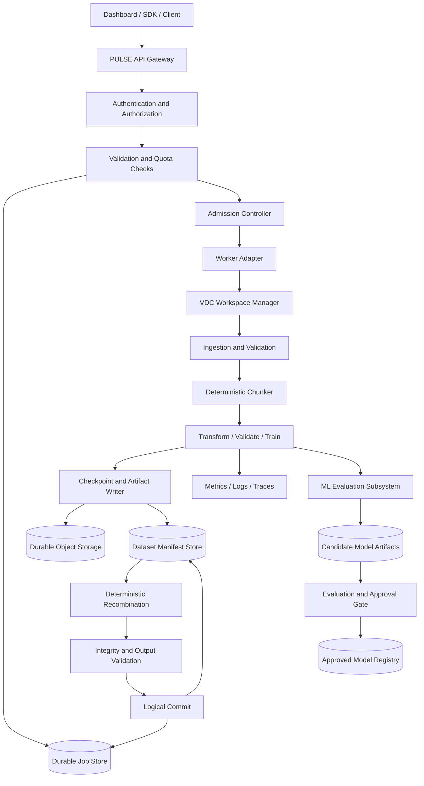
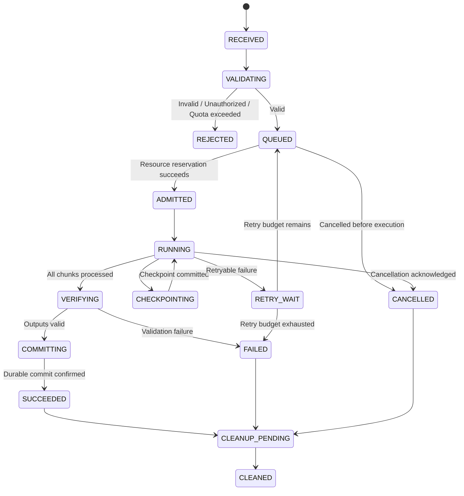

# PULSE Server + Virtual Dataset Container Engine (VDC)

## Autonomous Synthetic Dataset Processing and Self-Evolving Machine Learning — Engineering Specification

**Document Version:** 2.1  
**Status:** Engineering specification and implementation blueprint  
**Prepared:** 25 October 2026  
**Author:** Debang Chowdhury and Core Scientific Engineering Team  
**Repository:** https://github.com/GOD-DEBANG/Container

> **Verification notice:** This document specifies the proposed architecture, mathematical models, implementation requirements, and verification procedures. It does not independently prove that the current source code implements every feature, that performance targets have been achieved, that security isolation is sufficient, or that a standards-compliance assessment has been completed.

---

# Table of Contents

1. Executive Summary
2. Scope and Terminology
3. Architecture and System Boundaries
4. Job Lifecycle and State Machine
5. Data Model and Persistence
6. Mathematical Specification
   - 6.1 Byte-Accurate Chunk Allocation
   - 6.2 Minimum Chunk Size and Edge Cases
   - 6.3 Chunk Sizing and Processing Overhead
   - 6.4 Resource Capacity and Throughput
   - 6.5 Resource Admission
   - 6.6 Queue Stability and Scheduling
   - 6.7 Progress and ETA
   - 6.8 Retries and Checkpoints
   - 6.9 Integrity and Manifests
   - 6.10 Drift Detection
   - 6.11 ML Training Objective
   - 6.12 Model Evolution and Regression Control
   - 6.13 Storage and Quota Accounting
7. Core Algorithms
8. API and Module Contracts
9. Security and Privacy
10. Failure Handling and Recovery
11. Observability and SLOs
12. Testing and Empirical Verification
13. Deployment and Vercel Constraints
14. Standards and Traceability
15. Engineering Assumptions and Limitations
16. Implementation Roadmap
17. Equation-to-Code Traceability Matrix
18. Benchmark Report Template
19. References

---

# 1. Executive Summary

PULSE is the request-handling and coordination layer. The Virtual Dataset Container Engine (VDC) provides a temporary, resource-aware execution workspace for dataset ingestion, chunking, transformation, validation, recombination, and artifact management.

The machine-learning subsystem consumes versioned datasets to conduct training and evaluation experiments. It may recommend model changes based on measured evidence, but candidate models must pass defined evaluation and approval gates before promotion.

The system is designed around the following lifecycle:

1. Validate the request, identity, permissions, input metadata, and quotas.
2. Create a durable job record and immutable input manifest.
3. Divide the input into deterministic chunks.
4. Admit work only when applicable resource budgets permit execution.
5. Process chunks with bounded concurrency, checkpoints, retries, and idempotent output writes.
6. Validate chunk outputs and recombine them deterministically.
7. Commit the output manifest and dataset version.
8. Record final job status and audit events.
9. Clean up temporary artifacts according to retention policy.
10. Run ML evaluation and controlled model promotion when requested.

## 1.1 Design Principles

- Correctness before throughput.
- Explicit CPU, memory, storage, network, and execution budgets.
- Deterministic chunk identifiers and ordering.
- Durable job state independent of temporary workers.
- Idempotent output commits despite repeated execution attempts.
- Separate estimated progress from confirmed committed progress.
- Versioned datasets, transformations, models, and experiment configurations.
- Evidence-based model evolution.
- Reproducible performance measurements.
- Least-privilege access to every job, dataset, and artifact.

## 1.2 Important Resource Constraint

The system does not use zero CPU, zero RAM, or zero I/O. Software processing necessarily consumes resources.

The engineering objective is to:

- minimize unnecessary copying and buffering;
- stream data when the format and libraries permit it;
- use bounded working sets;
- avoid loading complete datasets into memory unnecessarily;
- schedule work within measured or conservatively estimated budgets;
- persist checkpoints and results durably.

A virtual workspace is not automatically equivalent to a secure operating-system container.

---

# 2. Scope and Terminology

## 2.1 Definitions

| Term | Definition |
|---|---|
| PULSE | API and coordination layer |
| VDC | Virtual Dataset Container Engine |
| Job | Durable record describing an operation |
| Workspace | Temporary logical workspace for a job |
| Chunk | Deterministic unit of input work |
| Subchunk | Smaller processing unit within a chunk |
| Manifest | Versioned description of input/output objects and metadata |
| Worker | Process that executes one or more work units |
| Resource budget | Maximum permitted CPU time, memory, storage, network, or runtime |
| Dataset version | Immutable logical snapshot of dataset content and metadata |
| Checkpoint | Durable record of completed work sufficient for safe recovery |
| Candidate model | Model artifact undergoing evaluation |
| Model promotion | Controlled transition of a candidate into an approved model version |
| Committed progress | Work whose output has been durably written and validated |
| Estimated progress | Approximation derived from worker counters or throughput |

## 2.2 In Scope

- Dataset ingestion and validation.
- Deterministic chunking.
- CPU-first resource-aware processing.
- Temporary workspace management.
- Checkpointing and recovery.
- Retry-safe output writing.
- Dataset manifests and versioning.
- ML training and evaluation workflows.
- Drift detection and candidate-model governance.
- Metrics, testing, and deployment verification.

## 2.3 Out of Scope Unless Separately Implemented

- Kernel-level isolation merely because a component is named a container.
- Guaranteed GPU availability.
- Unlimited execution time on serverless platforms.
- Automatic production model deployment without evaluation.
- Guaranteed zero-copy operation for all file formats.
- Formal certification based solely on this document.
- Universal performance guarantees independent of hardware and provider limits.

---

# 3. Architecture and System Boundaries

## 3.1 Logical Architecture



## 3.2 PULSE API Gateway

Responsibilities:

- authenticate requests or delegate to the configured identity provider;
- validate request schemas and payload limits;
- enforce authorization and tenant ownership;
- create durable job records;
- return a job ID for asynchronous processing;
- expose status, progress, cancellation, and error details;
- avoid treating an accepted HTTP request as proof that the job completed.

## 3.3 Scheduler and Admission Controller

Responsibilities:

- evaluate concurrency limits and tenant quotas;
- estimate or reserve resources before execution;
- apply bounded queues and backpressure;
- prevent uncontrolled job admission;
- manage priorities and fairness;
- coordinate worker leases and cancellation;
- release reservations after completion or reconciliation.

## 3.4 VDC Workspace Manager

Responsibilities:

- create a unique temporary workspace for a job;
- associate every temporary artifact with a job and tenant;
- enforce workspace expiry and size limits;
- maintain chunk metadata and checkpoint references;
- clean up temporary files and objects;
- report cleanup failures separately from processing failures.

The workspace abstraction does not provide OS-level isolation unless an actual sandboxed runtime is used.

## 3.5 Dataset and Manifest Service

Responsibilities:

- track immutable dataset versions;
- store metadata and object references;
- maintain file size, hash, format, provenance, and validation state;
- ensure that incomplete outputs are not exposed as completed dataset versions;
- support integrity checks and reconciliation.

Large binary objects should generally be stored in object storage or an appropriate byte store, with metadata stored separately.

## 3.6 ML Subsystem

Responsibilities:

- train and evaluate candidate models against versioned datasets;
- record configuration, data splits, code version, and random seeds;
- measure task performance and resource consumption;
- detect potential distribution changes;
- reject candidates that fail defined evaluation gates;
- preserve rollback capability.

Drift detection is not, by itself, evidence that retraining will improve a model.

## 3.7 Trust Boundaries

1. Client to API: all client input is untrusted.
2. API to worker: workers receive authorized job references only.
3. Worker to storage: use scoped credentials and validated object references.
4. Tenant to tenant: enforce ownership in the data-access layer.
5. Temporary to durable data: verify output integrity before commit.
6. Candidate model to approved model: require evaluation and controlled promotion.

---

# 4. Job Lifecycle and State Machine



## 4.1 State Rules

- State transitions must be persisted.
- Only authorized transitions are accepted.
- Terminal job states must not be overwritten by stale workers.
- A job cannot become `SUCCEEDED` before output validation and durable commit.
- A cleanup failure must not erase the processing result.
- Cancellation may be cooperative if the execution platform cannot forcibly terminate work.

## 4.2 Minimum Job Record

```text
job_id
tenant_id
requested_by
operation_type
input_manifest_id
output_manifest_id
status
created_at
updated_at
started_at
completed_at
cancel_requested_at
attempt_count
max_attempts
priority
resource_request
resource_reservation_id
progress_estimate
committed_bytes
total_bytes
error_code
error_summary
idempotency_key
worker_lease_expires_at
version
```

Optional fields should be nullable where appropriate. Secrets and raw sensitive payloads must not be placed in ordinary job logs.

## 4.3 Idempotency

Each external operation should include an idempotency key scoped to the tenant and operation.

Store a hash of the normalized request with the key:

- same key and same request hash: return the original job;
- same key and different request hash: return a conflict;
- repeated chunk commit with the same stable identity: preserve one logical committed result.

Suggested chunk identity:

```text
(dataset_version, job_id, chunk_id, transform_version)
```

Use a transaction, conditional write, or compare-and-swap mechanism to prevent duplicate logical commits.

---

# 5. Data Model and Persistence

## 5.1 Suggested Entities

- `jobs`
- `job_attempts`
- `resource_reservations`
- `datasets`
- `dataset_versions`
- `dataset_objects`
- `chunk_manifests`
- `chunk_results`
- `model_runs`
- `model_artifacts`
- `model_evaluations`
- `model_registry`
- `audit_events`
- `tenant_quotas`

Use ownership fields and indexes that match real query patterns.

Potential indexes include:

```text
(tenant_id, created_at)
(job_id, chunk_id)
(dataset_id, version)
(model_id, created_at)
(status, updated_at)
```

These are design suggestions and should be adjusted to the actual database and workload.

## 5.2 Object Metadata

A manifest entry should include:

```json
{
  "object_id": "opaque-object-id",
  "logical_path": "normalized/path",
  "byte_length": 123456,
  "media_type": "application/octet-stream",
  "hash_algorithm": "sha256",
  "content_hash": "hex-digest",
  "chunk_index": 0,
  "source_version": "immutable-version-id",
  "validation_status": "validated"
}
```

The values are illustrative.

## 5.3 Source of Truth

Define one authoritative store for each kind of state.

For example:

- job status: durable database;
- manifest metadata: durable database;
- object bytes: object storage;
- temporary worker state: ephemeral workspace;
- approved model version: model registry.

If metadata and object bytes live in different systems, use immutable object references and a commit/reconciliation protocol.

---

# 6. Mathematical Specification

## 6.1 Notation

| Symbol | Meaning | Unit |
|---|---|---|
| \(S\) | Total input size | bytes |
| \(n\) | Number of chunks | count |
| \(w_i\) | Weight of chunk \(i\) | dimensionless |
| \(b_i\) | Bytes allocated to chunk \(i\) | bytes |
| \(V_j(t)\) | Effective rate for resource \(j\) | work units/s |
| \(V(t)\) | End-to-end effective throughput | work units/s |
| \(P(t)\) | Estimated progress fraction | fraction |
| \(C(t)\) | Committed progress fraction | fraction |
| \(M\) | Number of observations | samples |
| \(x\) | Feature vector | feature-dependent |
| \(\mu\) | Baseline feature mean | feature-dependent |
| \(\Sigma\) | Baseline covariance matrix | feature-dependent |
| \(\lambda\) | Covariance regularization coefficient | implementation-dependent |
| \(Q(t)\) | Queue length | jobs |
| \(\lambda_a\) | Average arrival rate | jobs/s |
| \(\mu_s\) | Average service rate | jobs/s |

Equations must be implemented with explicit units, assumptions, and validation rules.

---

## 6.1 Byte-Accurate Chunk Allocation

### 6.1.1 Weighted Largest-Remainder Allocation

Given total size \(S\in\mathbb{Z}_{\ge0}\) bytes and weights \(w_i\ge0\), with at least one positive weight:

\[
W=\sum_{j=1}^{n}w_j
\]

\[
q_i=S\frac{w_i}{W}
\]

\[
f_i=\lfloor q_i\rfloor
\]

\[
r_i=q_i-f_i
\]

\[
R=S-\sum_{i=1}^{n}f_i
\]

Allocate one additional byte to each of the \(R\) chunks with the largest fractional remainders.

The final allocation is:

\[
b_i=f_i+\mathbf{1}[i\text{ receives an additional byte}]
\]

Resolve equal remainders with a deterministic rule, such as ascending chunk index.

Under the stated conditions:

\[
\boxed{\sum_{i=1}^{n}b_i=S}
\]

and:

\[
b_i\in\mathbb{Z}_{\ge0}
\]

This guarantees byte conservation, but it does not guarantee that every chunk is nonempty.

### 6.1.2 Exact Integer Formulation

If weights are nonnegative integers, define:

\[
W=\sum_i w_i
\]

For each chunk:

\[
a_i=S w_i
\]

\[
f_i=\left\lfloor\frac{a_i}{W}\right\rfloor
\]

\[
r_i=a_i\bmod W
\]

Then allocate the remaining bytes to the largest integer remainders \(r_i\).

This avoids floating-point remainder comparisons and is preferred when deterministic integer weights are available.

Use sufficiently wide integer arithmetic to avoid overflow in \(S w_i\).

---

## 6.2 Minimum Chunk Size and Edge Cases

If every chunk must contain at least \(m\) bytes, feasibility requires:

\[
\boxed{S\ge nm}
\]

Reserve the minimum first:

\[
S'=S-nm
\]

Then allocate the remaining bytes:

\[
b_i=m+\operatorname{LargestRemainder}_i(S',w)
\]

If \(S<nm\), the requested configuration is infeasible. Reduce the chunk count, reduce the minimum size, or reject the configuration.

### Edge Cases

- If \(S=0\), represent an empty input explicitly.
- If \(n=0\), accept only when no chunks are required.
- If all weights are zero, reject or use a documented equal-weight fallback.
- Reject negative, NaN, or infinite weights.
- If the requested chunk count exceeds the number of available bytes and nonempty chunks are required, reduce the count or reject the request.
- Do not silently convert zero-byte chunks into positive-size chunks, because that breaks byte conservation.

### 6.2.1 Contiguous Byte Ranges

Represent a chunk using a half-open interval:

\[
[a_i,e_i)
\]

where:

\[
b_i=e_i-a_i
\]

For an ordered, gap-free partition:

\[
a_1=0
\]

\[
e_i=a_{i+1}
\]

\[
e_n=S
\]

Therefore:

\[
\sum_{i=1}^{n}(e_i-a_i)=S
\]

Half-open intervals prevent double-counting boundary bytes.

For CSV, JSON, compressed files, media, and other structured formats, chunk boundaries must respect the format or use a parser-aware splitting method.

---

## 6.3 Chunk Sizing and Processing Overhead

Let:

- \(S\) be total input bytes;
- \(b\) be target bytes per chunk;
- \(h\) be fixed overhead per chunk in seconds;
- \(v\) be measured processing throughput in bytes/s.

Estimated chunk count:

\[
n=\left\lceil\frac{S}{b}\right\rceil
\]

Approximate serial execution time:

\[
T_{\text{serial}}\approx\frac{S}{v}+nh
\]

This is a planning model, not a guaranteed execution time.

Small chunks increase scheduling and metadata overhead. Large chunks increase retry cost and may increase memory requirements.

For a transformation with estimated working-set multiplier \(\alpha\):

\[
M_{\text{required}}\approx\alpha b+M_{\text{fixed}}
\]

where \(M_{\text{fixed}}\) includes interpreter, library, and other fixed runtime overhead.

Measure \(\alpha\) for each transformation rather than assuming it is one.

---

## 6.4 Resource Capacity and Throughput

### 6.4.1 Distinguish Capacity from Rate

These are different quantities:

- CPU capacity: effective cores and execution time;
- memory capacity: available bytes;
- memory bandwidth: bytes transferred per second;
- storage capacity: bytes available;
- storage throughput: bytes read or written per second;
- network bandwidth: theoretical transfer capacity;
- network goodput: successfully delivered payload bytes per second;
- provider execution limits: allowed runtime, memory, and concurrency.

RAM capacity is a resource-admission constraint. It is not itself a throughput value.

### 6.4.2 Bottleneck Approximation

When each resource rate is expressed in the same work unit per second:

\[
V_{\text{effective}}(t)\le\min_j V_j(t)
\]

A simplified estimate is:

\[
\widehat V(t)=
\min\{
V_{\text{CPU}}(t),
V_{\text{memory-bandwidth}}(t),
V_{\text{storage}}(t),
V_{\text{network}}(t),
V_{\text{provider}}(t)
\}
\]

This approximation applies to a simple bottleneck model. Pipelines with overlapping I/O, multiple stages, compression, caching, or different units require a more detailed model.

### 6.4.3 CPU-Bound Service Estimate

A rough CPU-bound estimate is:

\[
V_{\text{CPU}}\approx
\frac{N_{\text{effective}}f_{\text{effective}}\eta}{c}
\]

where:

- \(N_{\text{effective}}\): effective parallel cores;
- \(f_{\text{effective}}\): effective cycles per second per core;
- \(\eta\): useful-work efficiency, between zero and one;
- \(c\): estimated CPU cycles per unit of work.

This estimate must be calibrated against actual measurements. Nominal CPU frequency does not guarantee a fixed processing rate.

### 6.4.4 Network Goodput

Estimate network goodput using successful payload bytes over an interval:

\[
V_{\text{network}}=
\frac{\text{successfully transferred payload bytes}}{\Delta t}
\]

Track errors, retransmissions, latency, and provider throttling separately.

Do not assume that bandwidth divided by \(1+\text{packet-loss rate}\) is a generally valid throughput formula.

---

## 6.5 Resource Admission

For every applicable resource \(j\), admission must satisfy:

\[
\text{used}_j+\text{reserved}_{j,k}\le\text{budget}_j
\]

For memory:

\[
M_{\text{used}}+M_{\text{estimated},k}+M_{\text{safety}}
\le M_{\text{budget}}
\]

The reservation must be recorded atomically or protected by a valid lease.

If exact resource telemetry is unavailable, use conservative per-job limits and the hosting platform's documented limits.

Admission checks should include:

- estimated working memory;
- active worker concurrency;
- temporary storage;
- maximum job duration;
- upload and download budgets;
- tenant quotas;
- provider-specific runtime restrictions.

---

## 6.6 Queue Stability and Scheduling

For a simplified single-server queue:

\[
\rho=\frac{\lambda_a}{\mu_s}
\]

where \(\lambda_a\) is average arrival rate and \(\mu_s\) is average service rate.

A necessary stability condition for this simplified model is:

\[
\rho<1
\]

This is not sufficient to prove that a real distributed queue meets its latency targets. Variable job sizes, retries, multiple workers, and provider throttling must be measured.

### 6.6.1 Backpressure

When queue length or estimated queue wait exceeds configured limits, the system should:

- reject new work;
- defer work;
- return a retryable response;
- lower admission rate;
- or request additional worker capacity where supported.

Do not accept unlimited jobs while implying immediate execution.

### 6.6.2 Priority Score

An optional policy score is:

\[
S_k=\alpha_pP_k+\alpha_aA_k+\alpha_fF_k-\alpha_cC_k
\]

where:

- \(P_k\): configured priority;
- \(A_k\): age or fairness factor;
- \(F_k\): deadline urgency;
- \(C_k\): estimated cost;
- \(\alpha\): policy weights.

Normalize each factor and define starvation prevention. This is a scheduling policy, not a physical law.

---

## 6.7 Progress and ETA

### 6.7.1 Estimated Progress

For work units with weights \(u_i\) and estimated completion \(z_i(t)\in[0,1]\):

\[
P(t)=\frac{\sum_i u_i z_i(t)}{\sum_i u_i}
\]

For byte-oriented work:

\[
P_{\text{bytes}}(t)=
\frac{\text{reported processed bytes}}{\text{total expected bytes}}
\]

Clamp displayed values to the interval \([0,1]\).

If the total work is unknown, display indeterminate progress instead of inventing a percentage.

### 6.7.2 Committed Progress

For each unit, count progress only after durable write and validation:

\[
C(t)=
\frac{
\sum_i u_i\mathbf{1}[\text{unit }i\text{ committed}]
}{
\sum_i u_i
}
\]

A worker heartbeat, local buffer write, or temporary output is not proof of durable completion.

### 6.7.3 Trapezoidal Throughput Integration

For measured throughput \(V_k\) and \(V_{k+1}\) at times \(t_k\) and \(t_{k+1}\):

\[
\Delta W_k\approx
\frac{V_k+V_{k+1}}{2}(t_{k+1}-t_k)
\]

Then:

\[
\widehat W(t_m)=W_0+\sum_{k=0}^{m-1}\Delta W_k
\]

This is a numerical estimate. It can overcount if throughput includes retries, repeated bytes, or uncommitted work.

Use authoritative chunk counters for actual completion and integration for planning or ETA.

### 6.7.4 ETA

For remaining work \(W_r\) and robust recent throughput estimate \(\widetilde V\):

\[
\text{ETA}\approx\frac{W_r}{\widetilde V}
\]

Suppress ETA when throughput is zero, the sample window is too short, or the workload is not comparable.

Display queue wait separately from execution ETA.

---

## 6.8 Retries and Checkpoints

### 6.8.1 Exponential Backoff

\[
d_k=\min(d_{\max},d_0 2^k)\cdot U(1-j,1+j)
\]

where:

- \(d_0\): initial delay;
- \(d_{\max}\): maximum delay;
- \(k\): retry index;
- \(j\): jitter fraction;
- \(U\): uniform random factor.

Use a maximum attempt count and a maximum retry time window.

Retry only classified transient failures. Do not repeatedly retry authorization failures or deterministic invalid input.

### 6.8.2 Checkpoint Fields

A checkpoint should include:

- job ID and attempt ID;
- chunk ID;
- input manifest hash;
- transform/code version;
- completed cursor or record offset;
- output object reference;
- output hash;
- checkpoint timestamp;
- schema version.

Commit checkpoint metadata only after the referenced output is durable.

On restart, verify the checkpoint and input version before resuming.

---

## 6.9 Integrity and Manifests

### 6.9.1 Object Hash

For object bytes \(B\):

\[
h=\operatorname{SHA256}(B)
\]

A hash allows comparison with a trusted expected digest. It does not independently prove authorship or origin.

### 6.9.2 Canonical Manifest Hash

For ordered manifest entries \(e_i\):

\[
H_M=
\operatorname{SHA256}
\left(
\operatorname{CanonicalSerialize}(e_1,\ldots,e_n)
\right)
\]

Canonical serialization must define:

- field order;
- character encoding;
- number representation;
- null handling;
- entry ordering;
- escaping rules.

Hashing arbitrary JSON serialization is insufficient unless the serialization is canonical.

If authenticity is required, protect expected hashes using signed manifests or a trusted audit mechanism.

---

## 6.10 Drift Detection

### 6.10.1 Mahalanobis Distance

For feature vector \(x\), baseline mean \(\mu\), and covariance matrix \(\Sigma\):

\[
D_M^2(x)=(x-\mu)^\top\Sigma^{-1}(x-\mu)
\]

This squared distance is sensitive to feature scaling and covariance quality.

### 6.10.2 Regularized Covariance

If covariance is singular or poorly conditioned, use:

\[
\Sigma_\lambda=\Sigma+\lambda I
\]

Then:

\[
D_{M,\lambda}^2(x)=
(x-\mu)^\top\Sigma_\lambda^{-1}(x-\mu)
\]

Select the regularization coefficient through validation or a documented shrinkage method.

Fit normalization and baseline statistics only on the designated baseline/training partition.

### 6.10.3 Threshold Calibration

Do not use a universal hardcoded threshold such as \(0.25\) without validation.

Define:

\[
\operatorname{flag}(x)=
\mathbf{1}[D_{M,\lambda}^2(x)>\tau]
\]

Choose threshold \(\tau\) based on held-out baseline data and the cost of false alarms versus missed drift.

Track:

- false-positive rate;
- detection delay;
- alert rate;
- precision and recall where labels exist;
- downstream model performance.

A drift alert triggers investigation or evaluation. It does not prove that retraining is needed.

---

## 6.11 ML Training Objective

### 6.11.1 Supervised Objective

For dataset \(\{(x_i,y_i)\}_{i=1}^{N}\), model \(f_\theta\), loss \(\ell\), and regularizer \(\Omega\):

\[
J(\theta)=
\frac{1}{N}\sum_{i=1}^{N}
\ell(f_\theta(x_i),y_i)
+\lambda_\Omega\Omega(\theta)
\]

### 6.11.2 Softmax

For logits \(z_{i,c}\):

\[
p_{i,c}=
\frac{e^{z_{i,c}}}
{\sum_{k=1}^{K}e^{z_{i,k}}}
\]

Use numerically stable log-softmax implementations in actual code.

### 6.11.3 Cross-Entropy

For one-hot or probability targets \(y_{i,c}\):

\[
\ell_i=
-\sum_{c=1}^{K}
y_{i,c}\log(\max(p_{i,c},\epsilon))
\]

The implementation must define a numerically safe \(\epsilon\) and use a stable loss implementation where available.

### 6.11.4 Gradient Update

For learning rate \(\eta\):

\[
\theta_{t+1}=\theta_t-\eta\nabla_\theta J_t(\theta_t)
\]

Record:

- optimizer;
- learning-rate schedule;
- batch size;
- random seed;
- number of epochs or steps;
- model architecture;
- preprocessing configuration;
- library versions;
- stopping criteria;
- training dataset version.

This equation describes a basic SGD update. The actual implementation may use another optimizer.

### 6.11.5 Dataset Splits

- Separate training, validation, and test data.
- Split by entity, source, or time when required to prevent leakage.
- Fit preprocessing statistics using training data only.
- Use validation data for model selection.
- Keep test data isolated until final evaluation.
- Store split IDs and manifest hashes.

---

## 6.12 Model Evolution and Regression Control

Adding hidden units or parameters does not automatically preserve old model behavior and does not guarantee freedom from catastrophic forgetting.

Let the previous model be \(f_{\theta_0}\) and the candidate be \(f_{\theta_1}\). For regression dataset \(D_{\text{reg}}\):

\[
\Delta_{\text{reg}}=
\frac{1}{|D_{\text{reg}}|}
\sum_{x\in D_{\text{reg}}}
d(f_{\theta_1}(x),f_{\theta_0}(x))
\]

where \(d\) is an output-distance measure suitable for the task.

Define a tolerated regression limit \(\delta\):

\[
\Delta_{\text{reg}}\le\delta
\]

This is an empirical gate on the selected evaluation set, not a guarantee for every possible input.

Possible techniques include:

- initializing added units to minimize their initial contribution where the architecture permits;
- distillation against the previous model;
- representative replay data where permitted;
- regularization;
- evaluation on old and new tasks;
- retaining the prior approved model for rollback.

Record the architecture change, parameter mapping, initialization method, dataset version, and evaluation results.

### 6.12.1 Candidate Promotion Gate

A candidate should be promoted only if it meets predefined criteria for:

- primary task performance;
- regression tests;
- relevant subgroup metrics;
- calibration where applicable;
- robustness and data quality;
- inference latency;
- resource consumption;
- safety constraints.

If the candidate fails, keep the prior approved model.

---

## 6.13 Storage and Quota Accounting

For objects with stored sizes \(s_i\):

\[
S_{\text{logical}}=\sum_i s_i
\]

Physical storage may differ due to compression, deduplication, replication, or provider-specific accounting.

Track, where available:

- logical bytes;
- physical or provider-reported bytes;
- temporary workspace usage;
- retained dataset versions;
- model artifact storage;
- egress usage.

Quota controls should include:

- maximum upload size;
- maximum tenant storage;
- temporary workspace size;
- concurrent jobs;
- maximum runtime;
- retry count;
- model artifact size;
- retention period;
- egress limits.

Reserve quota before expensive processing and reconcile reservations after completion or cleanup.

---

# 7. Core Algorithms

## 7.1 Deterministic Largest-Remainder Allocation

The following is reference pseudocode. For strict cross-platform determinism, use integer/rational arithmetic rather than floating-point remainder comparisons.

```python
def allocate_bytes(total_bytes, weights):
    if total_bytes < 0:
        raise ValueError("total_bytes must be non-negative")

    if not weights:
        if total_bytes == 0:
            return []
        raise ValueError("at least one weight is required")

    if any(w < 0 for w in weights):
        raise ValueError("weights must be non-negative")

    weight_sum = sum(weights)

    if weight_sum <= 0:
        raise ValueError("at least one weight must be positive")

    quotas = [
        total_bytes * w / weight_sum
        for w in weights
    ]

    base = [int(q) for q in quotas]
    remainder = total_bytes - sum(base)

    # Stable tie-breaking by original index.
    order = sorted(
        range(len(weights)),
        key=lambda i: (-(quotas[i] - base[i]), i)
    )

    for i in order[:remainder]:
        base[i] += 1

    assert sum(base) == total_bytes
    assert all(isinstance(x, int) and x >= 0 for x in base)

    return base
```

The production implementation must also define empty-input behavior, minimum chunk size, overflow handling, and deterministic arithmetic.

## 7.2 Worker Processing Loop

```text
1. Acquire a lease for the job and attempt.
2. Load the job and immutable input manifest.
3. Verify authorization and resource reservation.
4. Enumerate pending chunks in deterministic order.
5. For each chunk:
   a. Check cancellation and lease validity.
   b. Read or stream bounded input.
   c. Process using configured resource limits.
   d. Write output to a unique temporary object key.
   e. Validate output length, hash, and schema.
   f. Commit chunk result idempotently.
   g. Persist checkpoint and committed-progress counters.
6. When all chunks are committed, enter VERIFYING.
7. Recombine outputs deterministically if required.
8. Verify final output and manifest.
9. Commit the dataset version.
10. Mark the job SUCCEEDED only after commit confirmation.
11. Schedule cleanup and emit audit and metric events.
```

## 7.3 Recombination Rules

- Order chunks by stable index or explicit sequence key.
- Do not use worker completion order as output order.
- Verify that every expected chunk appears exactly once.
- For byte-range processing, verify contiguity and non-overlap.
- For record-based processing, define ordering and duplicate behavior.
- Use format-aware writers for structured or compressed files.
- Compute final output size and hash after recombination.

---

# 8. API and Module Contracts

The following endpoints are proposed contracts. They must be reconciled with the actual repository before being described as implemented.

## 8.1 Suggested API

| Method | Endpoint | Purpose |
|---|---|---|
| POST | `/api/v1/jobs` | Validate and create a job |
| GET | `/api/v1/jobs/{job_id}` | Read job status |
| POST | `/api/v1/jobs/{job_id}/cancel` | Request cancellation |
| GET | `/api/v1/jobs/{job_id}/events` | Read paginated events |
| POST | `/api/v1/datasets` | Create dataset metadata |
| POST | `/api/v1/datasets/{id}/versions` | Register a version |
| GET | `/api/v1/datasets/{id}/versions/{version}` | Read manifest metadata |
| POST | `/api/v1/models/runs` | Start training/evaluation |
| GET | `/api/v1/models/runs/{run_id}` | Read ML run status |
| POST | `/api/v1/models/{model_id}/promotions` | Request gated promotion |

## 8.2 HTTP Semantics

Suggested mappings:

- `202 Accepted`: asynchronous job accepted;
- `400 Bad Request`: invalid schema;
- `401 Unauthorized`: missing or invalid authentication;
- `403 Forbidden`: insufficient permissions;
- `409 Conflict`: idempotency conflict or incompatible state;
- `413 Payload Too Large`: input exceeds configured limit;
- `429 Too Many Requests`: rate or quota limit;
- `5xx`: server or transient infrastructure error.

Actual status codes must match the implemented API framework and platform.

## 8.3 Error Envelope

```json
{
  "error": {
    "code": "RESOURCE_LIMIT_EXCEEDED",
    "message": "The requested job exceeds the configured resource budget.",
    "request_id": "opaque-request-id",
    "retryable": false
  }
}
```

Do not expose stack traces, secrets, internal filesystem paths, or sensitive tenant information.

## 8.4 Suggested Module Structure

```text
pulse/
  api/
  auth/
  validation/
  jobs/
  scheduler/
  resources/
  vdc/
    workspace/
    ingestion/
    chunking/
    processing/
    recombination/
    cleanup/
  datasets/
    manifests/
    integrity/
    versions/
  ml/
    datasets/
    training/
    evaluation/
    drift/
    registry/
  persistence/
  observability/
  security/
  tests/
```

This is a proposed structure, not a verified description of the current repository.

---

# 9. Security and Privacy

## 9.1 Minimum Controls

- Authentication and authorization on every protected operation.
- Tenant ownership checks on jobs, datasets, manifests, and artifacts.
- Input schema validation and payload-size limits.
- File-type inspection and safe parser configuration.
- Path traversal prevention.
- Malware scanning or quarantine where appropriate.
- Encryption in transit and provider-supported encryption at rest.
- Managed secret storage.
- Short-lived scoped storage credentials where supported.
- API key hashing when only verification is needed.
- Rate limiting and quota enforcement.
- Audit logging.
- Retention and deletion policies.
- Dependency review and vulnerability scanning.
- Redaction of secrets and sensitive payloads from logs.

## 9.2 Threat Model

Consider:

- malformed or malicious uploads;
- oversized files and decompression bombs;
- cross-tenant data access;
- forged job identifiers;
- replayed requests;
- worker compromise;
- leaked API keys;
- resource exhaustion;
- corrupted or replaced object versions;
- data poisoning;
- prompt injection in ML input;
- degraded candidate-model promotion;
- accidental logging of personal data.

## 9.3 Temporary Workspace Cleanup

1. Mark the workspace as cleanup-pending.
2. Select only objects owned by that workspace/job.
3. Delete objects through the storage API.
4. Verify deletion where supported.
5. Record cleanup results.
6. Retry failures with bounded attempts.
7. Run an orphan reconciler for expired workspaces.

Never delete objects based only on a broad prefix that could overlap another tenant or job.

## 9.4 Container Isolation Warning

A temporary directory, Python object, database record, or class named `Container` is not a security boundary for arbitrary executable code.

If users can submit code or arbitrary training scripts, use a separately secured execution environment with appropriate OS-level isolation, restricted networking, filesystem controls, resource limits, and a reviewed threat model.

If such isolation is unavailable, restrict execution to trusted transformations and supported operations.

---

# 10. Failure Handling and Recovery

## 10.1 Failure Categories

| Category | Example | Default Handling |
|---|---|---|
| Invalid input | Unsupported format | Terminal failure |
| Authorization | Permission denied | Fail safely |
| Quota/resource rejection | Budget exceeded | Reject or defer |
| Transient provider error | Temporary 5xx | Bounded retry |
| Worker interruption | Process termination | Resume from verified checkpoint |
| Integrity failure | Hash mismatch | Quarantine and investigate |
| Commit conflict | Stale version | Reconcile; do not overwrite blindly |
| Cleanup failure | Object deletion failed | Retry asynchronously |
| Model regression | Candidate fails gate | Reject candidate |

## 10.2 Recovery Invariants

- `SUCCEEDED` references a durable, validated output manifest.
- A dataset version is not visible as complete before commit.
- Retries cannot overwrite unrelated output.
- A missing checkpoint can be recovered by reprocessing the last durable unit.
- An expired worker lease cannot commit using stale authority.
- Cancellation and cleanup status are tracked independently.
- Cleanup failure does not erase the original job result.

## 10.3 Reconciliation Jobs

Periodically inspect:

- expired worker leases;
- jobs stuck in nonterminal states;
- orphaned temporary objects;
- manifest/object hash mismatches;
- stale quota reservations;
- completed jobs awaiting cleanup;
- model artifacts without a final registry state.

Reconciliation must be idempotent and record repairs in the audit log.

---

# 11. Observability and SLOs

## 11.1 API Metrics

- request count by route and status;
- latency distribution;
- authentication failures;
- authorization failures;
- validation errors;
- rate-limit events.

## 11.2 Worker and Scheduler Metrics

- queue depth;
- queue wait time;
- active jobs and chunks;
- job duration by operation and size band;
- retry count;
- failure category;
- lease expiration;
- cancellation latency;
- worker resource usage where available.

## 11.3 Storage Metrics

- bytes uploaded and downloaded;
- object read/write latency;
- checksum failures;
- committed versus estimated bytes;
- cleanup backlog;
- orphan count;
- quota reservation discrepancies.

## 11.4 ML Metrics

- training duration;
- training resource usage;
- dataset and code version;
- train/validation/test metrics;
- drift statistic and alert rate;
- candidate acceptance/rejection;
- rollback count;
- inference latency if serving is in scope.

## 11.5 SLO Definition

Do not claim targets such as `p50 < 20 ms`, `p99 < 100 ms`, cold start `< 300 ms`, or `10k+ requests/s` without a reproducible test report.

Every performance target must specify:

- endpoint and operation;
- payload size;
- request mix;
- concurrency and arrival pattern;
- region and deployment plan;
- warm-up and cache state;
- test duration;
- error-rate threshold;
- percentile calculation;
- whether downstream work and queue wait are included.

A valid SLO is tied to a defined workload and observation window.

---

# 12. Testing and Empirical Verification

## 12.1 Test Layers

1. Unit tests.
2. Property-based tests.
3. Database and storage integration tests.
4. Fault-injection tests.
5. Security tests.
6. Load and stress tests.
7. ML evaluation tests.
8. Deployment-environment tests.

## 12.2 Required Properties

### Byte Conservation

For every valid allocation:

\[
\sum_i b_i=S
\]

\[
b_i\in\mathbb{Z}_{\ge0}
\]

### Partition Correctness

Verify:

- first range starts at zero;
- last range ends at total size;
- every range has nonnegative length;
- ranges are contiguous;
- ranges do not overlap;
- every byte belongs to exactly one range.

### Idempotency

Repeated commits with the same idempotency key must produce one logical committed result.

Reusing a key with different content must fail safely.

### Crash Recovery

Inject worker termination at each durable boundary. Verify that no false success state or corrupted committed version results.

### Determinism

Given the same input manifest, algorithm version, configuration, and seed where relevant, chunk allocation and canonical manifests should be reproducible.

ML reproducibility depends on the framework, hardware, parallelism, and operations used. State the achieved reproducibility level rather than claiming universal determinism.

## 12.3 Benchmark Methodology

Record:

- commit SHA;
- runtime and library versions;
- deployment provider, region, and plan;
- machine or worker class;
- dataset size and type;
- warm-up;
- repetition count;
- median, p95, and p99;
- variance or confidence interval;
- error rate;
- memory and CPU telemetry;
- cache state;
- exact command and raw output.

A router microbenchmark does not measure full API throughput. An in-memory hashing benchmark does not measure end-to-end storage throughput.

## 12.4 Benchmark Table

| Test | Workload | Metric | Result |
|---|---|---|---|
| API status endpoint | Defined payload and concurrency | p50/p95/p99 | Not measured |
| Chunk allocation | Defined size and chunk count | Duration | Not measured |
| File ingestion | Defined format and size | MB/s and error rate | Not measured |
| SHA-256 | Defined memory/storage conditions | MB/s | Not measured |
| Recovery | Injected failure | Integrity and recovery rate | Not measured |
| ML training | Defined model/data/hardware | Duration and task metrics | Not measured |

Do not replace “Not measured” with estimates presented as facts.

---

# 13. Deployment and Vercel Constraints

Vercel may be suitable for the frontend and lightweight API/orchestration layer. Suitability for long-running CPU-heavy dataset processing or model training depends on the configured runtime and current platform limits.

## 13.1 Suggested Deployment Split

### Vercel request path

- authentication;
- input validation;
- job creation;
- job status queries;
- signed upload/download URL issuance;
- lightweight orchestration.

### Durable services

- job and manifest metadata;
- object storage for large files;
- durable model artifact storage;
- optional external queue or worker service.

### Worker layer

Use an external worker or job platform for processing that exceeds the configured serverless runtime, memory, or execution limits.

### Progress reporting

Workers persist checkpoints and progress. Clients poll or subscribe through a supported mechanism.

## 13.2 Deployment Checklist

- [ ] Confirm handler entrypoints.
- [ ] Verify runtime and region.
- [ ] Verify timeout and memory limits.
- [ ] Verify request/response body limits.
- [ ] Verify bundle size and dependency compatibility.
- [ ] Verify streaming support if required.
- [ ] Avoid treating local filesystem storage as durable.
- [ ] Move long-running work to an appropriate worker.
- [ ] Configure database and object storage permissions.
- [ ] Configure secrets through environment settings.
- [ ] Test cancellation and cleanup in the deployed environment.
- [ ] Run staging load and fault-injection tests.
- [ ] Set cost and quota alerts.
- [ ] Verify current official platform documentation before production deployment.

Do not assume a serverless runtime is a persistent machine or that a background process will continue indefinitely after the request returns.

---

# 14. Standards and Traceability

This document may be prepared with reference to practices associated with:

- IEEE 730: Software Quality Assurance Processes;
- IEEE 1016: Software Design Descriptions;
- ISO/IEC/IEEE 42010: Architecture Description;
- ISO/IEC/IEEE 29148: Requirements Engineering.

The exact edition and applicability must be verified.

Mentioning a standard does not establish conformance or certification.

Before claiming compliance:

1. identify the exact edition and relevant clauses;
2. create a clause-to-artifact compliance matrix;
3. review the required processes and deliverables;
4. record approval evidence;
5. resolve gaps;
6. retain audit records.

Maintain traceability from requirement to design, code, test, and evidence.

---

# 15. Engineering Assumptions and Limitations

1. The throughput minimum is a simplified bottleneck model.
2. CPU cycle estimates vary with runtime, hardware, workload, and contention.
3. Network goodput must be measured.
4. Throughput integration estimates work; it does not prove persistence.
5. Mahalanobis distance depends on feature scaling and covariance quality.
6. Drift does not prove that retraining is beneficial.
7. Adding neural-network parameters does not guarantee preservation of old behavior.
8. Hashes detect changes only when compared with a trusted expected digest.
9. Application-level VDC workspaces are not automatically OS-level containers.
10. Serverless platforms impose runtime, memory, payload, and persistence constraints.
11. Passing local tests does not establish production-scale capacity.
12. No performance numbers are asserted in this specification because no reproducible benchmark report is attached.
13. Data retention, privacy, and training rights must be defined for each dataset and applicable jurisdiction.
14. Proposed module names and API endpoints must be checked against the actual source code.
15. Standards references require edition and applicability verification.
16. No security, compliance, or production-readiness guarantee follows from the equations alone.

---

# 16. Implementation Roadmap

## Phase A — Correctness Foundation

- [ ] Define immutable input and output manifests.
- [ ] Implement deterministic chunk IDs.
- [ ] Implement byte allocation and property tests.
- [ ] Define empty-input and minimum-size behavior.
- [ ] Implement idempotency keys.
- [ ] Implement conditional output commits.
- [ ] Implement durable job state transitions.
- [ ] Separate estimated and committed progress.

## Phase B — Execution Safety

- [ ] Add resource budgets.
- [ ] Add admission checks.
- [ ] Add bounded queues and backpressure.
- [ ] Add worker leases and fencing tokens.
- [ ] Add checkpoints and bounded retries.
- [ ] Define cancellation semantics.
- [ ] Add cleanup and orphan reconciliation.

## Phase C — Persistence and Security

- [ ] Declare the source of truth for each entity.
- [ ] Enforce tenant ownership.
- [ ] Add upload validation and size limits.
- [ ] Add secret management and log redaction.
- [ ] Add audit events.
- [ ] Define retention and deletion policies.
- [ ] Decide whether arbitrary code execution is forbidden or sandboxed.

## Phase D — ML Governance

- [ ] Version datasets and splits.
- [ ] Record model run configuration and artifact hashes.
- [ ] Calibrate drift thresholds.
- [ ] Define candidate evaluation gates.
- [ ] Define promotion and rollback procedures.
- [ ] Test regression and relevant subgroup metrics.

## Phase E — Evidence and Operations

- [ ] Add metrics, traces, and dashboards.
- [ ] Run unit, property, integration, security, and fault tests.
- [ ] Run representative load tests.
- [ ] Produce reproducible benchmark reports.
- [ ] Verify deployed provider limits.
- [ ] Map requirements to code and tests.
- [ ] Review standard references.
- [ ] Approve production readiness only after evidence review.

---

# 17. Equation-to-Code Traceability Matrix

Replace the generic implementation areas with actual source paths and test IDs after repository inspection.

| ID | Requirement | Expected implementation area | Required evidence |
|---|---|---|---|
| M-01 | Largest-remainder allocation | Chunk allocator | Byte-conservation property tests |
| M-02 | Minimum chunk feasibility | Configuration validator | Boundary and infeasible cases |
| M-03 | Half-open range partition | Range planner | Gap/overlap tests |
| M-04 | Resource admission | Scheduler/resource manager | Concurrent reservation tests |
| M-05 | Queue stability/backpressure | Queue/scheduler | Overload and recovery tests |
| M-06 | Estimated vs committed progress | Progress service | Crash-before-commit tests |
| M-07 | Retry policy | Retry manager | Backoff and attempt-limit tests |
| M-08 | Object integrity | Artifact writer | Corruption detection tests |
| M-09 | Canonical manifest hash | Manifest serializer | Cross-run determinism tests |
| M-10 | Regularized drift detector | ML drift module | Singular covariance and calibration tests |
| M-11 | Training objective/evaluation | ML runner | Reproducible baseline run |
| M-12 | Candidate regression gate | Model registry | Rejection and rollback tests |
| M-13 | Quota reconciliation | Quota service | Crash and orphan-reservation tests |
| S-01 | Tenant authorization | API/data-access layer | Cross-tenant denial tests |
| S-02 | Workspace cleanup | Cleanup worker | Repeated cleanup and orphan tests |
| O-01 | SLO measurement | Telemetry/load tests | Raw benchmark report |
| D-01 | Deployment assumptions | Deployment configuration | Staging runtime verification |

---

# 18. Benchmark Report Template

Copy this template for each experiment.

```text
Experiment ID:
Date and time:
Commit SHA:
Purpose:
Operation measured:
Input dataset/object:
Input size:
Chunk count:
Chunk-size distribution:
Runtime and dependency versions:
Deployment provider:
Region and plan:
Worker class:
CPU and memory:
Concurrency:
Warm-up:
Run count:
Cache state:
Command or test procedure:
Raw output location:
Median:
p95:
p99:
Throughput:
Error rate:
Peak memory:
CPU utilization:
Storage/network observations:
Failure injection:
Known confounders:
Conclusion:
Reviewer:
```

A performance claim is approved only when another engineer can reproduce the measurement or inspect trustworthy raw telemetry.

---

# 19. References

Verify all bibliographic details and exact editions before formal publication.

1. IEEE Std 730, *IEEE Standard for Software Quality Assurance Processes*. Confirm the applicable edition.
2. IEEE Std 1016, *IEEE Standard for Information Technology—Systems Design—Software Design Descriptions*. Confirm the applicable edition.
3. ISO/IEC/IEEE 42010, *Systems and software engineering—Architecture description*. Confirm the applicable edition.
4. ISO/IEC/IEEE 29148, *Systems and software engineering—Life cycle processes—Requirements engineering*. Confirm the applicable edition.
5. P. C. Mahalanobis, “On the generalised distance in statistics,” *Proceedings of the National Institute of Sciences of India*, 1936.
6. G. M. Amdahl, “Validity of the Single Processor Approach to Achieving Large Scale Computing Capabilities,” *AFIPS Spring Joint Computer Conference*, 1967.
7. K. He et al., “Delving Deep into Rectifiers: Surpassing Human-Level Performance on ImageNet Classification,” ICCV, 2015. This is relevant to initialization, not proof that model expansion preserves behavior.
8. A verified primary or authoritative source for the exact largest-remainder/apportionment algorithm used by the implementation.
9. Current official documentation for the selected hosting provider, database, object storage, authentication provider, ML framework, and benchmark tools.

Record access dates and version numbers for online technical documentation.

> **Citation hygiene:** Do not use uncertain bibliographic details as verified references. A reference must support the specific claim for which it is cited. Verify titles, authors, publication venues, years, pages, DOIs, and standard editions before academic submission.

---

# Final Engineering Statement

This specification establishes a structured basis for implementing and verifying PULSE + VDC, including:

- byte-accurate chunk allocation;
- resource admission and scheduling;
- progress semantics;
- retry and recovery behavior;
- integrity manifests;
- drift detection;
- ML evaluation and model promotion;
- storage quotas;
- security boundaries;
- observability;
- deployment constraints;
- testing and traceability.

It is an engineering specification, not proof of implementation or experimental success.

Describe the system as implemented, benchmarked, securely isolated, standards-conformant, or production-ready only when the corresponding source-code review, test results, benchmark evidence, security assessment, or compliance review exists.
